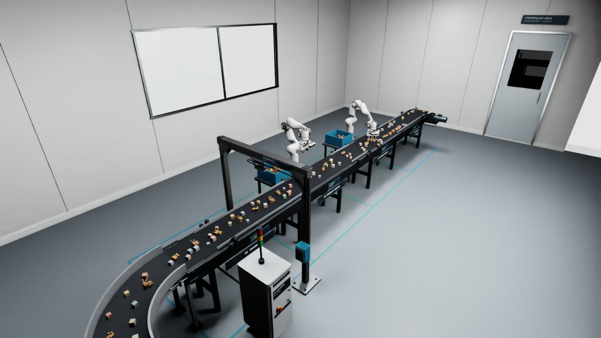
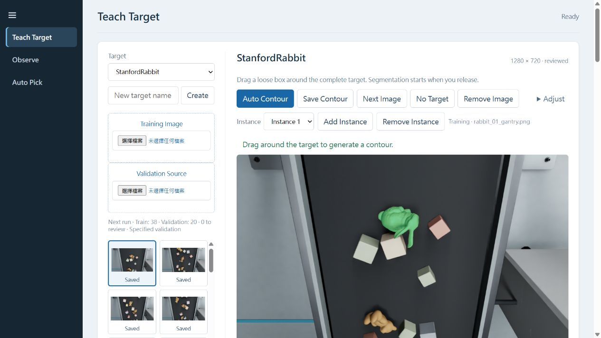
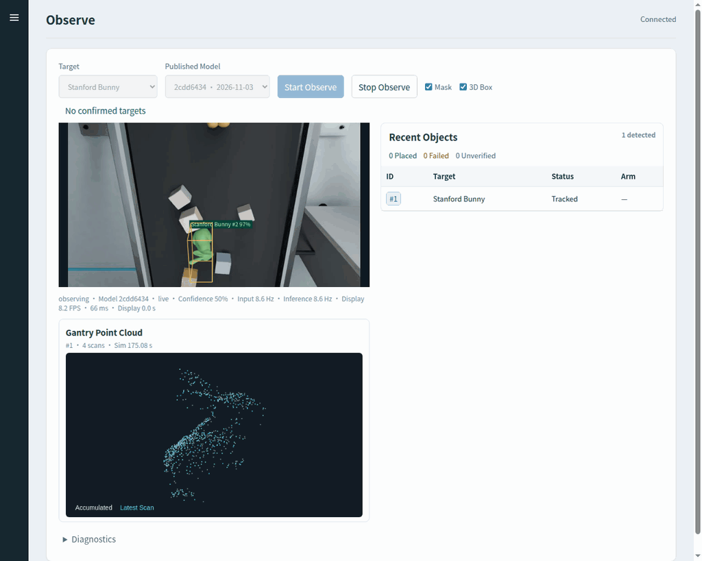
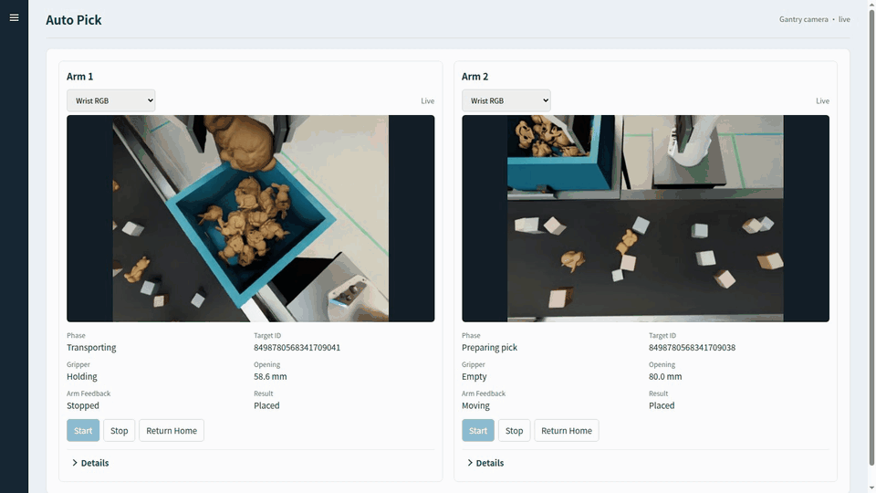
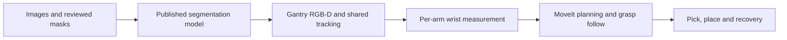

# VisionGuidedPick

**Teach a target. Track it on a conveyor. Pick and place with two robot arms.**

VisionGuidedPick is a robotics simulation demo built with NVIDIA Isaac Sim, ROS 2 and MoveIt 2. A browser-based workspace connects image annotation and model training to RGB-D tracking and continuous dual-arm pick-and-place.



The example scene contains Stanford Bunny, a bear and colored blocks. The overhead camera recognizes the selected target; each arm uses its wrist camera to refine the same tracked object's position and capture a grasp surface before attempting a pick.

[Getting started](docs/getting-started.md) · [Workflow](#workflow) · [Architecture](#architecture) · [License](#license)

## What it does

- **Teach Target:** upload images, review instance masks, train a segmentation model, inspect validation results and publish a model version.
- **Observe:** run the published model on gantry RGB-D, display masks and 3D bounds, and maintain shared object identities and a short motion-aligned point-cloud history.
- **Auto Pick:** run either or both arms continuously using wrist measurements, moving-target grasp planning and the existing pick/place recovery flow.
- **Track outcomes:** inspect per-arm state, joint and gripper feedback, and recent object outcomes in the same workspace.

This is an experimental simulation project. Stanford Bunny is the current end-to-end example; teaching another object's appearance does not establish that its grasping behavior will generalize.

## Workflow

### 1. Teach Target

To try the supplied Bunny demo model, run Setup and go directly to Observe.
For your own target, create a target and upload images covering the expected poses, distances, lighting and background conditions. Review the generated masks, correct individual instances, and mark distractor-only images **No Target**. Keep separate images for validation. Click **Train**, inspect the results, then **Publish Model**.



Training uses RF-DETR instance segmentation. SAM 2 assists annotation. Training parameters live in `config/teaching.yaml`; the required dataset size depends on scene variation and validation results. Setup registers the supplied demo model; your own targets still use this teaching workflow.

### 2. Observe

Press **Play** in Isaac Sim, select a published model and click **Start Observe**. The workspace shows masks, depth-supported 3D bounds, shared target IDs and the gantry point cloud. Select an object ID to inspect its cached surface, or use **Follow Latest**.



The animation shows target segmentation and point-cloud visualization in Isaac Sim. [Static screenshot](docs/media/observe.jpg) · [Media credits](docs/media/README.md).

### 3. Auto Pick

Open **Auto Pick** and click **Start** for either or both arms. The gantry supplies upstream tracking; the assigned arm uses a wrist top-view measurement to refine the target and plan its grasp. Both stations can work concurrently, with the downstream arm able to attempt targets left on the conveyor.



The animation shows grasp planning and pick-and-place in Isaac Sim.

An empty failed attempt returns through the existing Home recovery before another cycle. Possible possession uses the existing bin-release recovery. **Stop** cancels continuous operation; **Return Home** requests recovery using measured feedback. A command acknowledgement alone does not prove a successful physical placement.

## Quick start

```bash
git clone https://github.com/MortCat/VisionGuidedPick.git
cd VisionGuidedPick
```

After installing the [platform prerequisites](docs/getting-started.md), clone this
repository. Isaac Sim is opened separately with the matching project launcher.

Native Linux:

```bash
bash setup.sh --isaac-root /path/to/isaacsim # First-time setup
bash start.sh                              # Backend/Web and App
bash start.sh --no-app                     # Backend/Web, browser access
bash stop.sh
```

Windows with an Ubuntu WSL backend:

```powershell
./setup.ps1 --isaac-root C:/isaacsim --wsl-distribution Ubuntu-24.04
./start.ps1
./start.ps1 --no-app
./stop.ps1
```

Setup installs dependencies, builds the application and registers the pinned
**Stanford Bunny demo model** from this repository's model Release. Select it in
Observe without training first. The model follows its own upstream terms;
see [installation and updates](docs/getting-started.md).


Start never installs, downloads a model, presses Play or starts arm tasks. Use
Isaac Play, Start Observe and Auto Pick Start when ready. Closing the App stops
its matching backend/Web through the existing lifecycle; in `--no-app` mode,
closing a browser tab does not stop services. Use `bash stop.sh --status` on Linux
or `./stop.ps1 --status` on Windows for status.

The root exposes only platform `setup`, `start` and `stop` entries. Shared Python
coordination and the Web-service lifecycle live under `deployment/`; Teach Target
has no separate launch mode. LAN access retains the configured host/client policy.

## Architecture



The runtime uses C++17 for core decisions, vision geometry and robot coordination. Python provides the Web service, training, model inference and simulator integration. `ptc_core` is independent of ROS 2 and Isaac Sim; MoveIt remains an optional backend package. Simulator ground truth is reserved for synthetic labels and evaluation, outside production perception and control.

| Location | Contents |
| --- | --- |
| `ros2_ws/src/` | Core, ROS interfaces, perception, task coordination and motion packages |
| `tools/teach_target/` | Product UI/API, annotation and model workers |
| `config/` | Application, training, perception and robot settings |
| `deployment/` | Factory scene, simulator integration and platform launchers |
| `docs/` | Setup, workflow, architecture and interface contracts |

[Product workflow](docs/architecture/product-workflow.md) · [System blueprint](docs/architecture/blueprint.md) · [ROS 2 contract](docs/architecture/ros2-interface-contract.md) · [Web API](docs/api/teach-target-api.md) · [Configuration](docs/configuration/settings.md)

## Requirements and limitations

- Ubuntu 24.04, ROS 2 Jazzy, MoveIt 2 and Python 3.12 for the application. An NVIDIA GPU and a compatible driver are needed for Isaac Sim and CUDA-based training/inference.
- Native Linux is the primary deployment. Windows/WSL is an experimental deployment profile. Match simulator, ROS library and asset versions using the [setup guide](docs/getting-started.md).
- Occlusion, incomplete depth and target geometry affect tracking and grasping. Objects can slip; reliable handling of arbitrary taught objects is not established.
- Five-face inspection and defect classification are outside this workflow.

## License

Original code, documentation, authored USD layers, meshes, materials and textures use the [MIT License](LICENSE). Referenced, embedded and derived third-party content keeps its own terms.

The scene uses NVIDIA robot/camera assets and materials, Stanford Bunny geometry, and external ML components. Read [third-party notices](THIRD_PARTY_NOTICES.md), [asset provenance](docs/release/asset-provenance.md) and [media credits](docs/media/README.md) before redistributing scenes, screenshots, datasets or model weights. Source: [MortCat/VisionGuidedPick](https://github.com/MortCat/VisionGuidedPick).
