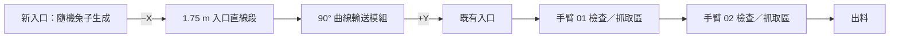

# L 型入口擴充方案

狀態（2026-10-05）：**L 型硬體與分段接觸輸送已建立**，保留既有直線雙臂工作區。新增 `l_inlet.usda`，32 段彎道、內外導軌、支腳與驅動外殼；原鼻端滾輪已下移，避免銜接凸緣。良品全程、斷耳與放大尺寸兔的彎道探針已完成 52 秒模擬，三者均進入 +Y 主線。每六秒進料的連續測試另記於 `l_feed_probe.json`。

這是第一版與代表性驗證；尚未完成所有類型、朝向、兩侧極限位置的長時間壓力測試，也尚未加入彎道占用監測與背壓控制。相機環繞與抓取控制不屬於本次輸送擴充驗證。

## 布局

新增入口位於現有輸送帶的前端、操作側，兔子先沿世界 −X 移動，再轉彎接入現有 +Y 主線。

| 段落 | 配置（世界座標，公尺） |
| --- | --- |
| 新生成點 | 約 `(2.93, -3.60, 0.755)`，沿 Y 做橫向随机偏移 |
| 新直線段中心線 | `(3.05, -3.60)` 至 `(1.30, -3.60)`，長 1.75 m，方向 −X |
| 90° 曲線中心 | `(1.30, -2.90)`，中心線半徑 0.70 m |
| 曲線入口 | `(1.30, -3.60)` |
| 曲線出口 | `(0.60, -2.90)`，相切方向 +Y |
| 既有雙臂主線 | X=0.60、Y=-2.90 至 +2.90 |
| 全線帶面 | 寬 0.35 m、高 0.75 m、帶速 0.06 m/s |

現有地板範圍 X=-3.30 至 4.20、Y=-4.50 至 4.50；此候選配置落在地板內。仍需檢查牆面、控制箱與配線的碰撞和維修空間，地板內不等於所有機構已無干涉。

## 實作順序與通過條件

1. 建立獨立 USD 入口段及 90° 曲線模組，包含框架、支腳、內外導軌、驅動與防護機構。
2. 直線段表面速度為 `(-0.06, 0, 0)`；主線維持 `(0, 0.06, 0)`。曲線使用分段接觸表面，方向隨弧線切線變化，初始以 32 段評估接縫。
3. 帶面接觸、摩擦與導軌真正帶動兔子轉送，不用逐幀改兔子的位置或瞬移過彎。
4. 橫向生成範圍按新直線段的 Y 寬度與兔子旋轉外形計算；既有 +Y 主線仍使用世界 X 寬度。Target feed 讀取實際物理速度向量，不能全線硬編碼成 +Y。
5. 加入入口、彎前、彎後占用監測；需要背壓策略，避免彎道入口堆積。
6. 全部兔子類型、不同朝向與兩側進料位置均須在六秒節奏下通過彎道，不掉落、不卡住、不反向，並銜接原有雙臂區。

新增中心線長約 2.85 m，依目前帶速增加約 **47.5 秒模擬時間**的入站等待。Demo 可在開始錄影前預填／暖機輸送線；不能以提高全線帶速掩蓋尚未驗證的彎道穩定性。

工業形式參考 [Dorner C3 Compact Curve Conveyor](https://www.dornerconveyors.com/products/fabric-modular-belts/c3-compact-curve-conveyor)。其官方資料列出曲線輸送與 90° 選項；以上尺寸是本場景的模擬候選設計，並非廠商型號規格，也沒有宣稱 reproducing 該產品的內部驅動機構。
